<div align="center">

# NETWORKWALKS-B084-WEEK4

## Black-Box Penetration Testing & Vulnerability Assessment
</div>

## Project Overview

| Category | Details |
|---|---|
| **Client** | Mediroza General Hospital |
| **Assessment Type** | Black-Box Penetration Testing & Vulnerability Assessment |
| **Program** | NetworkWalks Cybersecurity Internship Program |
| **Batch** | B084 |
| **Duration** | 5 Days |
| **Testing Environment** | Kali Linux |
| **Authorisation** | Written permission provided through NetworkWalks |
| **Target** | `medirozahospital.com` |

This project involved conducting an authorised black-box penetration test against the Mediroza General Hospital web application. The assessment focused on evaluating the application's external attack surface, identifying security vulnerabilities and determining whether weaknesses could expose confidential patient, employee and organisational information.

Testing was conducted without prior access to source code, internal architecture or administrative credentials. All activities remained within the authorised assessment scope.

---

# 1. Executive Summary

This report documents the final penetration testing assessment undertaken as part of the NetworkWalks Cybersecurity Internship Program (B084).

The primary objective was to evaluate the security posture of the Mediroza General Hospital web application, identify vulnerabilities, validate their potential impact and provide practical remediation recommendations.

The engagement followed a black-box testing methodology, simulating an external security assessment in which the tester begins without privileged access or prior knowledge of the application's internal implementation.

The assessment incorporated the following techniques:

- Domain and DNS reconnaissance.
- Network service enumeration.
- Web application fingerprinting.
- Directory and resource enumeration.
- HTTP request and response analysis.
- Manual SQL injection testing.
- Automated SQL injection assessment.
- PDF password hash extraction and recovery.
- Sensitive information exposure analysis.
- Vulnerability validation and risk assessment.

## Key Findings

The assessment identified five confirmed security vulnerabilities.

| ID | Finding | Severity | Status |
|---|---|---|---|
| V01 | SQL Injection Authentication Bypass | High | Confirmed |
| V02 | Weak PDF Password Protection | Medium | Confirmed |
| V03 | Verbose MySQL Error Disclosure | Medium | Confirmed |
| V04 | Publicly Exposed SQL Database Backup | High | Confirmed |
| V05 | Directory Indexing Enabled | Medium | Confirmed |

### Critical Observations

**1. SQL Injection Authentication Bypass**

A SQL injection vulnerability within the patient login mechanism allowed authentication to be bypassed without valid account credentials. Successful exploitation provided access to the patient portal and three encrypted pathology reports.

**2. Publicly Exposed Database Backup**

A publicly accessible SQL database backup was discovered within the `/old/` directory. The backup contained confidential employee information, including salary and identification details, alongside shareholder records.

**3. Weak PDF Password Protection**

Three encrypted pathology reports were retrieved from the patient portal. Password verification hashes were extracted and successfully recovered using John the Ripper and dictionary-based password testing. All three documents were subsequently decrypted.

**4. Directory Indexing**

Directory indexing exposed application filenames, authentication endpoints, document download handlers and other internal application resources.

**5. Verbose Database Error Disclosure**

The patient login mechanism returned detailed MySQL syntax errors to unauthenticated users, exposing information about the underlying database implementation.

## Overall Risk Assessment

**Overall Risk: HIGH**

The combination of authentication weaknesses, insecure file storage and insufficient access controls presents a significant confidentiality risk.

The assessment demonstrated that weaknesses in application authentication and information storage could provide unauthorised access to protected patient resources and confidential organisational information.

Immediate remediation of the SQL injection vulnerability and publicly exposed database backup is recommended.

---

# 2. Scope and Methodology

## 2.1 Scope of Assessment

The engagement involved an authorised black-box penetration test against the Mediroza General Hospital web application.

Testing was conducted without prior access to the application's source code, internal architecture or administrator credentials.

The assessment was structured around four project milestones.

| Milestone | Objective | Result |
|---|---|---|
| M1 - Initial Access | Retrieve three encrypted patient PDF reports | Completed |
| M2 - Data Extraction | Recover the contents of all three PDF reports | Completed |
| M3 - Critical Data Exposure | Identify exposed staff salaries and shareholder information | Completed |
| M4 - Reporting | Document findings, evidence, risks and remediation recommendations | Completed |

## 2.2 Rules of Engagement

All testing was conducted within the authorised scope established through NetworkWalks.

The following restrictions applied:

- No denial-of-service or disruptive testing.
- No social engineering activities.
- No testing outside the authorised target scope.
- No intentional modification or destruction of server data.
- No unauthorised access to unrelated systems.
- Testing was conducted exclusively for educational and authorised security assessment purposes.

## 2.3 Testing Methodology

The assessment followed a structured penetration testing methodology consisting of seven stages.

| Stage | Activities |
|---|---|
| Reconnaissance | Gather publicly available domain, DNS and infrastructure information. |
| Enumeration | Identify exposed services, web technologies and application directories. |
| Vulnerability Identification | Investigate weaknesses in authentication, file storage and application configuration. |
| Exploitation | Validate identified vulnerabilities and demonstrate their potential impact within the authorised scope. |
| Data Exposure Assessment | Examine accessible database backups and encrypted documents. |
| Risk Assessment | Evaluate the severity and potential consequences of each finding. |
| Reporting | Document evidence, findings and remediation recommendations. |

## 2.4 Tools and Technologies

| Tool | Purpose |
|---|---|
| Kali Linux | Primary penetration testing environment |
| WHOIS | Domain registration reconnaissance |
| Nslookup | DNS resolution |
| DNSRecon | DNS record enumeration |
| Nmap | Network service and version detection |
| WhatWeb | Web application fingerprinting |
| Wafw00f | Web Application Firewall identification |
| cURL | HTTP response and header inspection |
| DirBuster | Web directory enumeration |
| Burp Suite | HTTP request and response interception and analysis |
| sqlmap | Automated SQL injection assessment |
| pdf2john | PDF password hash extraction |
| John the Ripper | Dictionary-based password recovery |
| SED | Text processing and hash-format normalisation |

---

# 3. Reconnaissance and Enumeration

The reconnaissance phase focused on identifying publicly available information, exposed network services, web technologies and potentially accessible application resources associated with Mediroza General Hospital.

Both passive and active reconnaissance techniques were used to establish an understanding of the target's external attack surface before conducting vulnerability testing.

## 3.1 WHOIS Enumeration

WHOIS was used to retrieve publicly available domain registration information and identify the associated nameservers.

The enumeration identified the following:

| Attribute | Result |
|---|---|
| Domain | `medirozahospital.com` |
| Registrar | Namecheap, Inc. |
| Registration Date | 14 August 2026 |
| Expiration Date | 14 August 2027 |
| Primary Nameserver | `dns1.namecheaphosting.com` |
| Secondary Nameserver | `dns2.namecheaphosting.com` |
| DNSSEC | Unsigned |

The results provided background information about the domain's registration and DNS infrastructure.

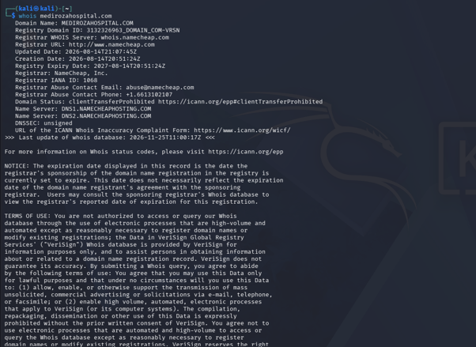

*WHOIS enumeration identifying domain registration details.*

## 3.2 DNS Enumeration

DNS enumeration was performed using Nslookup and DNSRecon to identify DNS records associated with the target domain.

The investigation identified the target's IP address as `199.188.201.16`.

Additional DNS information was collected to understand the domain's infrastructure and identify potentially exposed services.

The domain's DMARC policy was also identified as `p=none`. This configuration provides monitoring rather than enforcement and does not instruct receiving mail servers to reject or quarantine messages that fail DMARC authentication.

**Key observations:**

- Target IP address: `199.188.201.16`
- DNSSEC was not enabled.
- DMARC policy was configured as `p=none`.

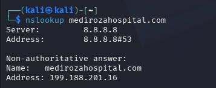

*Nslookup identifying the target's resolved IPv4 address.*

## 3.3 DNS Enumeration Using DNSRecon

DNSRecon was used to enumerate publicly available DNS records associated with the target domain.

The enumeration identified:

- **A Records:** Identified the website's IPv4 address.
- **NS Records:** Identified the authoritative nameservers.
- **MX Records:** Identified the domain's email infrastructure.
- **TXT Records:** Revealed SPF and DMARC configuration.
- **SRV Records:** Advertised calendar, contact and email-related services.

Two notable security observations were identified.

### DNSSEC Configuration

DNSRecon reported that DNSSEC was not configured.

DNSSEC provides an additional layer of DNS integrity protection by enabling the authentication of DNS responses.

### DMARC Configuration

The domain's published DMARC policy was configured as:

```text
p=none
```

This represents a monitoring-only policy rather than instructing receiving mail servers to quarantine or reject messages that fail DMARC authentication.

These observations were documented as potential security hardening opportunities rather than confirmed exploitable vulnerabilities.

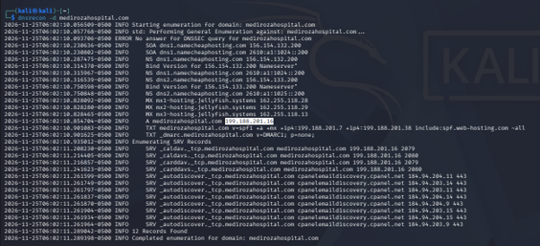

*DNSRecon enumeration identifying publicly available DNS records.*

## 3.4 Network Enumeration Using Nmap

Nmap was used to identify exposed TCP services and perform service version detection.

The initial scan was performed using:

```bash
nmap -sV 199.188.201.16
```

The scan identified the following services.

| Port | Service | Identified Technology |
|---|---|---|
| 21 | FTP | Pure-FTPd |
| 26 | SMTP | Exim 4.100.1 |
| 53 | DNS | BIND |
| 80 | HTTP | HAProxy / LiteSpeed |
| 110 | POP3 | Dovecot |
| 143 | IMAP | Dovecot |
| 443 | HTTPS | HAProxy / LiteSpeed |
| 465 | SMTPS | Exim 4.100.1 |
| 587 | SMTP | Exim 4.100.1 |
| 993 | IMAPS | Dovecot |
| 995 | POP3S | Dovecot |

The scan also identified the hostname:

```text
server274-1.web-hosting.com
```

This suggested that the target IP address was associated with shared hosting infrastructure.

### Additional Service Inspection

Further inspection of the FTP service identified:

- Pure-FTPd.
- Anonymous authentication disabled.
- TLS support advertised.

A separate MySQL connectivity check reported TCP port `3306` as filtered, preventing direct database service identification.

Although multiple services were exposed, their presence did not independently establish exploitable vulnerabilities.

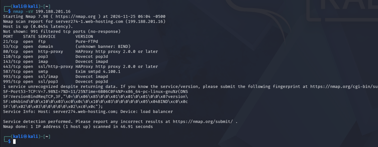

*Nmap service and version detection results.*

## 3.5 Web Application Fingerprinting Using WhatWeb

WhatWeb was used to identify technologies associated with the target web application.

The scan identified LiteSpeed as the web server technology.

The initial HTTP request returned:

```text
301 Moved Permanently
```

This indicated that traffic was being redirected to HTTPS.

The subsequent HTTPS request returned:

```text
403 Forbidden
```

during the fingerprinting process. This response occurred during the fingerprinting request and did not establish that the entire website was inaccessible.

The exact LiteSpeed version was not disclosed, preventing reliable identification of version-specific vulnerabilities.

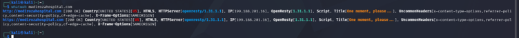

*WhatWeb identifying the web server technology.*

## 3.6 WAF Identification Using Wafw00f

Wafw00f was used to investigate whether the target was protected by a Web Application Firewall (WAF).

The tool identified a LiteSpeed-associated WAF.

This suggested that an application-layer security mechanism was potentially present.

However, the presence of a WAF did not prevent the SQL injection authentication bypass demonstrated during the later testing stages.

This highlights the importance of secure application development rather than relying exclusively on perimeter security mechanisms.

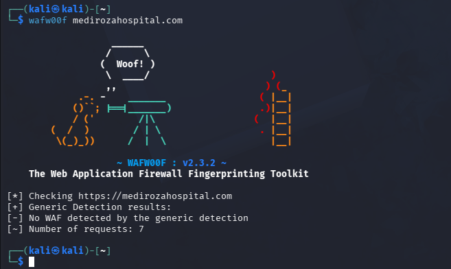

*Wafw00f identifying a LiteSpeed-associated Web Application Firewall.*

## 3.7 HTTP Header Inspection Using cURL

cURL was used to inspect the HTTP response headers returned by the target website.

The command used was:

```bash
curl -I https://medirozahospital.com
```

The server returned:

```http
HTTP/2 200
```

Additional response headers included:

```http
Server: LiteSpeed
Content-Type: text/html
Content-Length: 5445
Accept-Ranges: bytes
X-Turbo-Charged-By: LiteSpeed
```

These results confirmed the web server technology previously identified through WhatWeb.

No exact LiteSpeed version was disclosed.

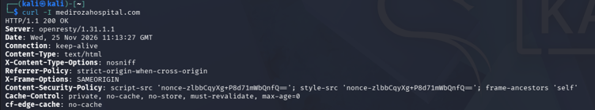

*HTTP response headers obtained using cURL.*

## 3.8 Directory Enumeration Using DirBuster

DirBuster was used to identify unlinked directories and potentially exposed application resources.

The enumeration identified several directories returning HTTP 301 redirects.

Further manual inspection revealed two particularly significant directories:

### A. `/old/`

The directory had indexing enabled and exposed a historical SQL database backup:

```text
mediroza_db_backup_2019.sql
```

The backup was accessible without authentication and contained confidential staff and shareholder information.

This represented a significant information disclosure vulnerability.

### B. `/patient/`

The patient directory also had indexing enabled, revealing application resources including:

```text
login.php
portal.php
download.php
logout.php
reports/
error_log
```

Direct access to the reports directory and error log returned HTTP 403 responses during testing.

However, the directory listing still exposed the application's file structure and helped identify the authentication and document download endpoints.

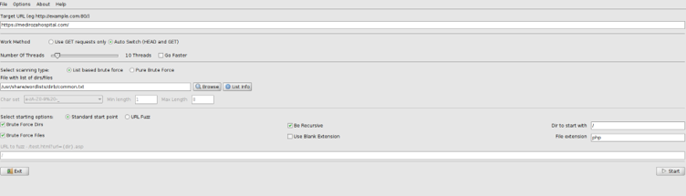

*DirBuster identifying potential application directories.*

### Exposed `/old/` Directory

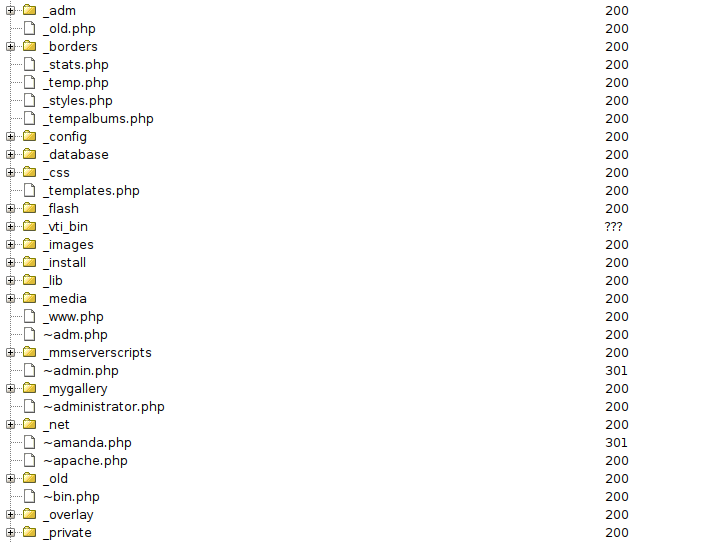

*Public directory listing exposing a historical SQL database backup.*

### Patient Directory Listing

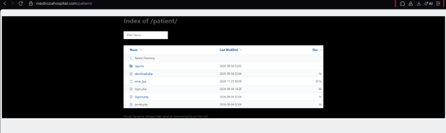

*Public directory listing revealing internal patient portal resources.*

The following screenshot provides additional evidence of the publicly accessible `/old/` directory and its contents.

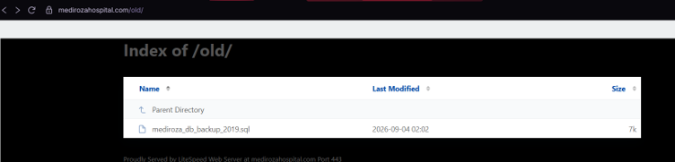

The directory contained a historical SQL database backup named:

```text
mediroza_db_backup_2019.sql
```

This discovery was investigated further and is documented in Section 4.4.

## 3.9 Reconnaissance Summary

The reconnaissance phase identified several important characteristics of the target environment.

| Tool | Key Finding |
|---|---|
| WHOIS | Domain registration and nameserver information |
| Nslookup | Target domain resolved to `199.188.201.16` |
| DNSRecon | DNS records, missing DNSSEC and monitoring-only DMARC policy |
| Nmap | Exposed network services and hosting infrastructure |
| WhatWeb | LiteSpeed web server identified |
| Wafw00f | LiteSpeed-associated WAF detected |
| cURL | HTTP response headers and server identification |
| DirBuster | Publicly accessible directories and application resources |

These discoveries provided the foundation for subsequent vulnerability testing, including SQL injection authentication bypass, encrypted PDF password recovery and sensitive database information exposure.

---

# 4. Findings and Proof of Exploitation

This section documents the vulnerabilities confirmed during the assessment, including their affected components, technical descriptions, supporting evidence and potential impact.

## 4.1 V01 - SQL Injection Authentication Bypass

| Attribute | Details |
|---|---|
| **Severity** | High |
| **CVSS v3.1** | 7.5 (Provisional) |
| **Affected Component** | Patient Portal Authentication |
| **Affected Endpoint** | `/patient/login.php` |
| **Status** | Confirmed |

### Description

During testing of the patient portal, SQL injection was identified within the authentication mechanism.

Initial testing produced MySQL syntax errors when SQL-specific input was submitted through the username parameter.

Further manual investigation demonstrated that the authentication mechanism could be bypassed without providing valid account credentials.

Automated testing using sqlmap did not initially identify the vulnerability. This highlighted the importance of manual testing and independent validation when assessing application-specific authentication mechanisms.

### Proof of Exploitation

Burp Suite was used to inspect the HTTP request and response associated with the successful authentication bypass.

Following the successful request, the application returned:

```http
HTTP/2 302
Location: portal.php
```

The redirect indicated that the application had proceeded to the patient portal.

Following the redirect, the portal displayed three encrypted pathology reports available for download.

This demonstrated that the authentication mechanism could be bypassed and that protected patient resources could subsequently be accessed without valid credentials.

**SQL Injection Authentication Bypass**

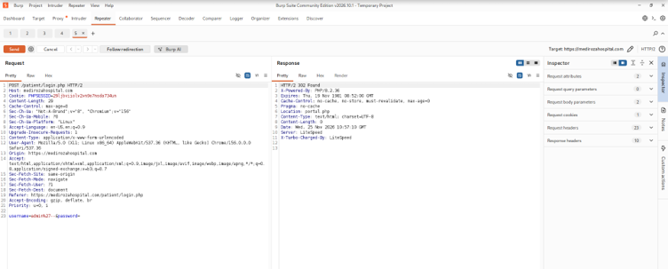

*Burp Suite showing the authentication request and successful redirect.*

**Patient Portal Access**

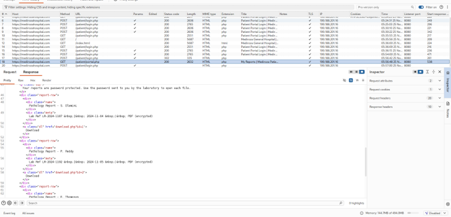

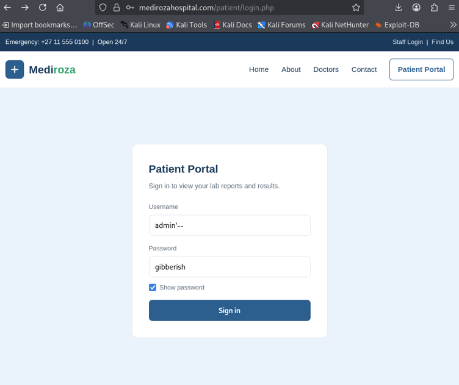

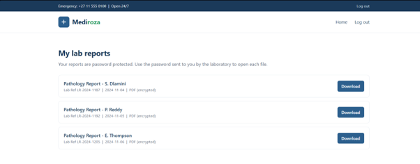

*Evidence of successful access to the patient portal and encrypted PDF reports.*

### Impact

Successful exploitation bypassed the application's authentication controls and provided access to protected patient resources.

Potential consequences include:

- Unauthorised access to confidential medical information.
- Breach of patient confidentiality.
- Exposure of sensitive pathology reports.
- Potential compromise of other resources protected by the same authentication mechanism.

The vulnerability represents a significant weakness in the application's access control architecture.

### Recommended Remediation

- Replace unsafe SQL query construction with parameterised queries and prepared statements.
- Ensure user input is treated as data rather than executable SQL syntax.
- Apply appropriate server-side input validation.
- Enforce authentication and authorisation checks for all protected resources.
- Review authentication logic for similar injection vulnerabilities.
- Conduct verification testing following remediation.

---

## 4.2 V02 - Weak PDF Password Protection

| Attribute | Details |
|---|---|
| **Severity** | Medium |
| **CVSS v3.1** | 5.5 (Provisional) |
| **Affected Component** | Encrypted Patient PDF Reports |
| **Affected Documents** | Three pathology reports |
| **Status** | Confirmed |

### Description

Following the authentication bypass, three encrypted pathology PDF reports were retrieved from the patient portal.

The reports were password protected, requiring additional testing to recover their contents.

Password verification hashes were extracted from the three documents using pdf2john and prepared for dictionary-based password recovery using John the Ripper.

### Hash Extraction and Troubleshooting

During the initial recovery attempts, John the Ripper returned:

```text
No password hashes loaded
```

Hashcat also reported a hash formatting error.

Further investigation identified a compatibility issue involving the PDF permissions field.

The extracted hash contained the unsigned value:

```text
4294967292
```

This value is equivalent to the signed 32-bit representation:

```text
-4
```

The permissions field was normalised using SED to resolve the compatibility issue.

This allowed John the Ripper to recognise and process the extracted hashes.

The normalisation changed the representation of the permissions value without intentionally altering the remaining encryption verification data.

### Extracted PDF Hashes

The password verification hashes were extracted from all three encrypted documents.

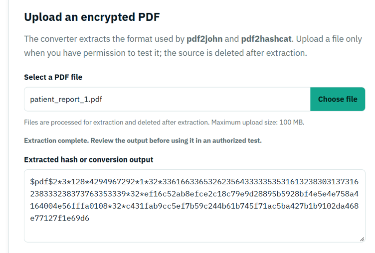

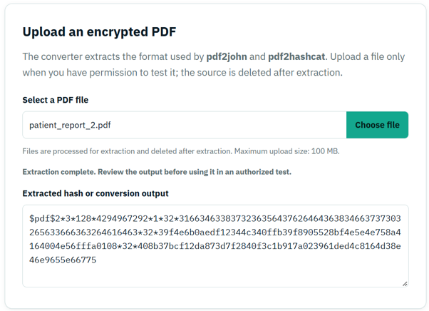

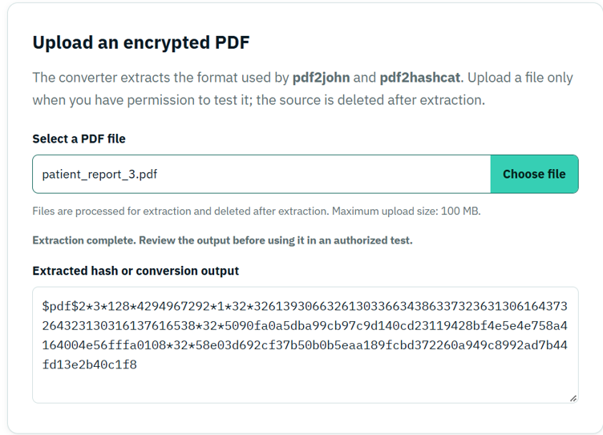

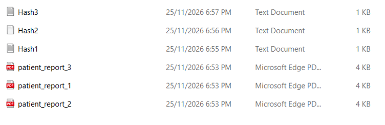

*Extracted password verification hashes from the three encrypted PDF documents.*

Password recovery was successful.

**Hash Normalisation**

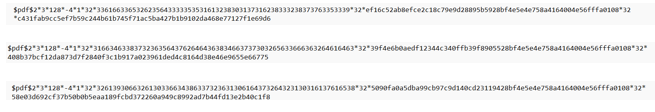

*PDF 1, 2, and 3 hash compatibility correction.*

### PDF 1 - Password Recovery

The first PDF hash was processed using John the Ripper.

**Password Recovery**

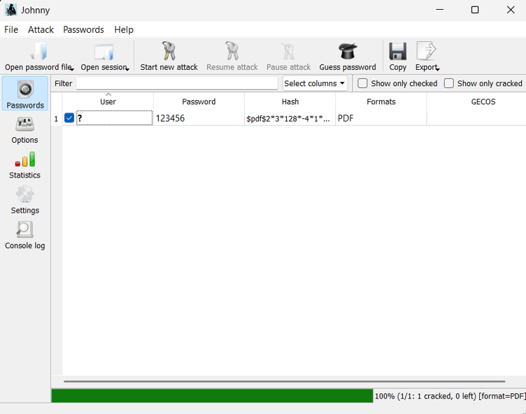

*Successful password recovery for PDF 1 using John the Ripper.*

### PDF 2 - Password Recovery

The second PDF was processed using the same extraction and recovery methodology.

John the Ripper successfully recovered the password using the selected wordlist.

**Password Recovery**

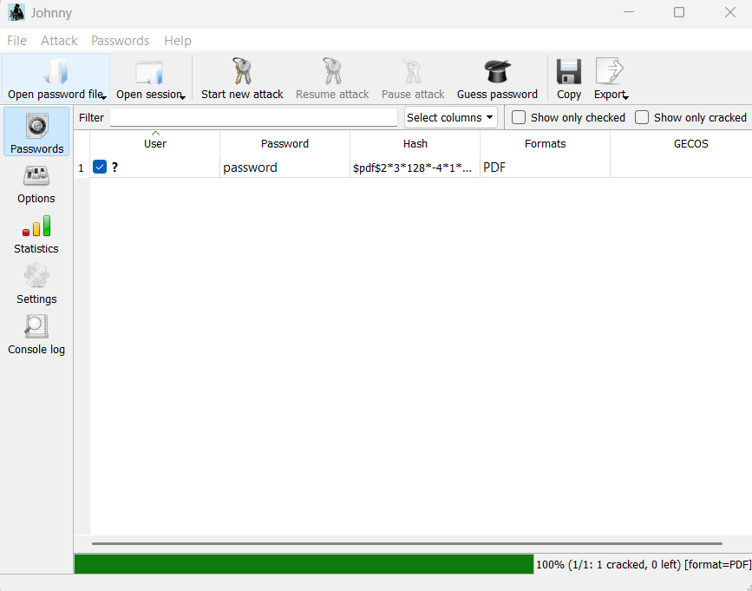

*Successful password recovery for PDF 2.*

### PDF 3 - Password Recovery

The third PDF was processed using the same extraction and recovery methodology.

The password was successfully recovered, completing the document recovery milestone.

**Password Recovery**

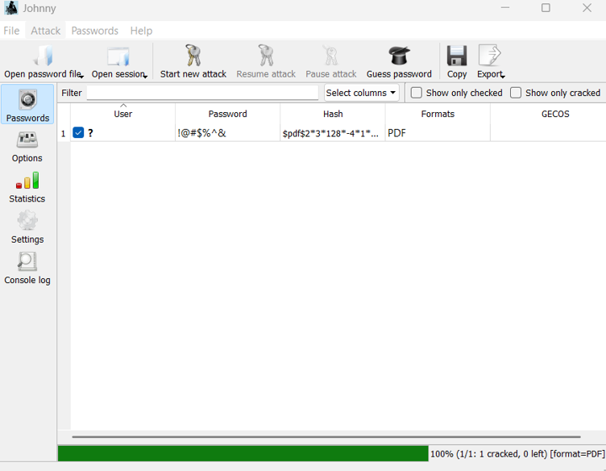

*Successful password recovery for PDF 3.*

### Results

| Document | Recovery Method | Result |
|---|---|---|
| Patient Report 1 | John the Ripper / Dictionary Attack | Successful |
| Patient Report 2 | John the Ripper / Dictionary Attack | Successful |
| Patient Report 3 | John the Ripper / Dictionary Attack | Successful |

**Result: All three PDF passwords were successfully recovered.**

Each recovered password successfully unlocked its corresponding encrypted pathology report.

### Decrypted Document Evidence

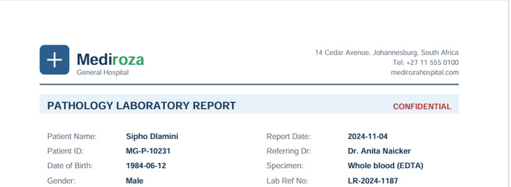

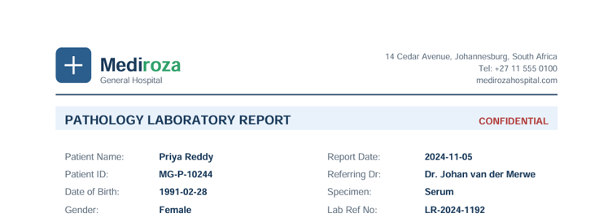

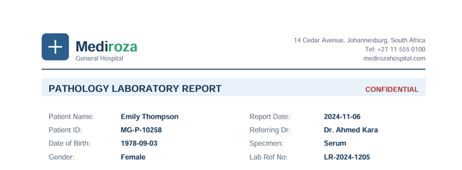

*Example of a successfully decrypted patient pathology report, with confidential information redacted. Potentially sensitive information has been omitted.*

### Impact

An attacker who obtains copies of the encrypted documents could potentially recover their passwords through offline dictionary-based guessing.

Successful recovery could provide access to confidential medical information without requiring further interaction with the hospital's web application.

This demonstrates that document encryption alone may be insufficient when password selection is weak or predictable.

### Recommended Remediation

- Require long, unique and unpredictable passwords for confidential documents.
- Avoid commonly used passwords and predictable keyboard patterns.
- Use modern PDF encryption settings.
- Distribute document passwords through secure channels.
- Consider stronger access-controlled document delivery mechanisms.
- Review the security of previously distributed encrypted documents.

---

## 4.3 V03 - Verbose MySQL Error Disclosure

| Attribute | Details |
|---|---|
| **Severity** | Medium |
| **CVSS v3.1** | 5.3 (Provisional) |
| **Affected Component** | Patient Portal Login |
| **Affected Endpoint** | `/patient/login.php` |
| **Status** | Confirmed |

### Description

During SQL injection testing, the patient login endpoint was observed returning detailed MySQL syntax errors through the PHP `mysqli_query()` function.

Instead of displaying a generic authentication failure, the application exposed database diagnostic messages containing information about the underlying SQL query and fragments of the submitted input.

This indicates that database errors were not being handled securely and that internal diagnostic information was being returned directly to unauthenticated users.

Such behaviour provides unnecessary insight into the application's backend implementation and may assist attackers in identifying weaknesses in its database query handling.

### Proof of Exposure

The issue was confirmed by submitting malformed input to the patient login endpoint and observing the resulting server response.

The application returned detailed MySQL syntax errors rather than suppressing the diagnostic information.

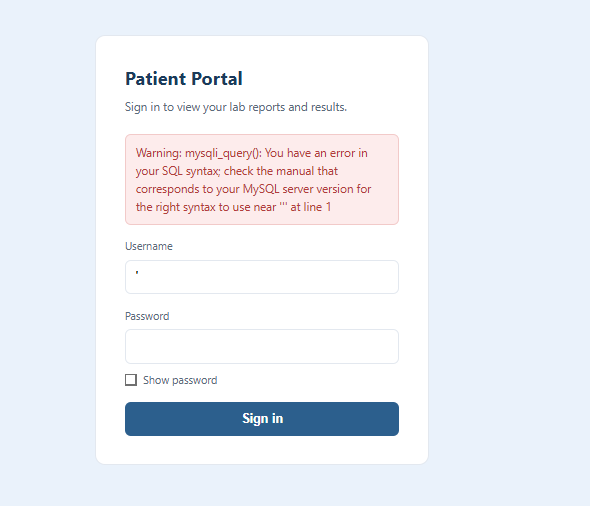

*Patient login endpoint exposing detailed MySQL syntax errors following malformed input.*

### Impact

Verbose database error messages can disclose information about the application's backend technologies, SQL query structure and database behaviour.

This information may help attackers understand how user input is processed and develop more targeted attacks against the application.

Although error disclosure does not independently demonstrate unauthorised database access or data compromise, it reduces the information-gathering effort required to investigate further vulnerabilities.

In this assessment, the exposed errors also provided additional insight during the identification and investigation of the SQL injection vulnerability affecting the same endpoint.

### Recommended Remediation

- Disable detailed database error output in production.
- Display generic authentication and application error messages.
- Store detailed diagnostic information in protected server-side logs.
- Implement secure exception handling.
- Review application error-handling behaviour during security testing.

---

## 4.4 V04 - Publicly Exposed SQL Database Backup

| Attribute | Details |
|---|---|
| **Severity** | High |
| **CVSS v3.1** | 7.5 (Provisional) |
| **Affected Component** | Web Server File Storage |
| **Affected Directory** | `/old/` |
| **Exposed File** | `mediroza_db_backup_2019.sql` |
| **Status** | Confirmed |

### Description

During directory enumeration, a publicly accessible directory listing was discovered under:

```text
/old/
```

The directory contained a historical SQL database backup named:

```text
mediroza_db_backup_2019.sql
```

The backup was accessible without authentication and contained database structures and populated records associated with confidential hospital information.

Further examination identified two particularly sensitive tables.

### Staff Table

The staff table contained employee information including:

- Employee names.
- Job titles.
- Departments.
- Contact details.
- National identification numbers.
- Monthly salary information.
- Employment dates.

The presence of populated records demonstrated that confidential employee information was exposed through the publicly accessible backup.

### Shareholders Table

The shareholders table contained organisational ownership information, including:

- Shareholder names.
- Ownership percentages.
- Share quantities.
- Share classifications.

Populated records confirmed that confidential organisational information was also exposed.

**Staff Database Exposure**

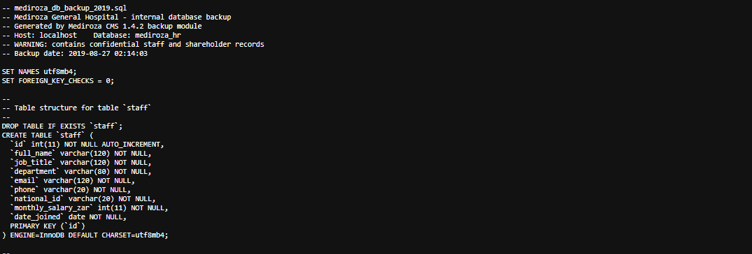

*SQL backup evidence showing exposed staff database information and confidential employee data categories. Potentially sensitive information has been omitted.*

### Impact

Public access to the database backup could expose confidential employee and organisational information to unauthorised parties.

Potential consequences include:

- Exposure of personally identifiable information.
- Identity-related risks arising from exposed identification details.
- Unauthorised disclosure of employee salary information.
- Targeted social engineering and phishing attacks.
- Exposure of confidential organisational ownership information.
- Reputational and regulatory consequences.

The vulnerability demonstrates the risks associated with storing database backups within publicly accessible web directories.

### Recommended Remediation

- Immediately remove database backups from publicly accessible directories.
- Store backups outside the public web root.
- Restrict backup access to authorised personnel.
- Review file permissions and backup retention practices.
- Examine server access logs for potentially unauthorised downloads.
- Assess whether incident response and breach notification procedures are required.
- Implement secure backup storage and access monitoring.

---

## 4.5 V05 - Directory Indexing Enabled

| Attribute | Details |
|---|---|
| **Severity** | Medium |
| **CVSS v3.1** | 5.3 (Provisional) |
| **Affected Components** | `/old/` and `/patient/` |
| **Status** | Confirmed |

### Description

Directory indexing was enabled on multiple web application directories.

The `/patient/` directory revealed application resources including:

```text
login.php
portal.php
download.php
logout.php
reports/
error_log
```

Although direct access to certain sensitive resources returned HTTP 403 responses, the public directory listing still exposed information about the application's internal file structure.

Directory indexing also contributed to the discovery of the publicly exposed SQL database backup within `/old/`.

### Proof of Exposure

The directory listing revealed application filenames and resources that were not otherwise immediately visible through normal website navigation.

The supporting directory enumeration evidence is provided in Section 3.8.

### Impact

Directory indexing can provide unauthorised users with information about an application's internal structure and available resources.

Potential consequences include:

- Identification of authentication and download endpoints.
- Discovery of sensitive application files.
- Improved reconnaissance opportunities.
- Increased likelihood of identifying improperly protected resources.

Although directory indexing is not necessarily exploitable by itself, it can increase the likelihood of discovering additional vulnerabilities.

### Recommended Remediation

- Disable directory indexing on public web directories.
- Restrict direct access to application logs, backups and sensitive resources.
- Review public directories for accidentally exposed files.
- Verify that authentication is enforced for protected resources.
- Apply appropriate server-side access restrictions.

---

# 5. Risk Rating and Assessment

The identified vulnerabilities were assessed based on their demonstrated impact, likelihood of exploitation and potential consequences for confidentiality, integrity and availability.

CVSS v3.1 was used as a reference framework for assigning provisional technical severity ratings.

## 5.1 Risk Rating Summary

| Finding ID | Vulnerability | CVSS v3.1 | Severity |
|---|---|---|---|
| V01 | SQL Injection Authentication Bypass | 7.5 | High |
| V02 | Weak PDF Password Protection | 5.5 | Medium |
| V03 | Verbose MySQL Error Disclosure | 5.3 | Medium |
| V04 | Publicly Exposed SQL Backup | 7.5 | High |
| V05 | Directory Indexing | 5.3 | Medium |

## 5.2 CVSS v3.1 Assessment

The following vector strings represent the provisional scoring assumptions used during the assessment.

### V01 - SQL Injection Authentication Bypass

```text
CVSS:3.1/AV:N/AC:L/PR:N/UI:N/S:U/C:H/I:N/A:N
```

**Score: 7.5 - High**

The vulnerability was remotely exploitable without prior authentication or user interaction.

Successful exploitation demonstrated significant confidentiality impact through unauthorised access to patient resources.

No integrity or availability impact was included because the assessment evidence demonstrated authentication bypass and access to protected resources, rather than modification or destruction of application data.

### V02 - Weak PDF Password Protection

```text
CVSS:3.1/AV:L/AC:L/PR:N/UI:N/S:U/C:H/I:N/A:N
```

**Score: 5.5 - Medium**

All three encrypted PDF reports were successfully recovered through dictionary-based password testing.

This assessment considers an attacker who has already obtained copies of the encrypted documents and can conduct offline password recovery.

The local attack vector reflects the offline password recovery activity rather than the initial remote retrieval of the documents. This assumption should be reviewed if the vulnerability is being scored specifically from the perspective of an external attacker obtaining the documents remotely.

### V03 - Verbose MySQL Error Disclosure

```text
CVSS:3.1/AV:N/AC:L/PR:N/UI:N/S:U/C:L/I:N/A:N
```

**Score: 5.3 - Medium**

Database error messages were exposed to unauthenticated users, revealing information about query behaviour and backend implementation.

The demonstrated impact was limited to information disclosure.

### V04 - Publicly Exposed SQL Backup

```text
CVSS:3.1/AV:N/AC:L/PR:N/UI:N/S:U/C:H/I:N/A:N
```

**Score: 7.5 - High**

The database backup was publicly accessible without authentication.

Its contents included confidential employee and shareholder information, resulting in significant confidentiality impact.

### V05 - Directory Indexing Enabled

```text
CVSS:3.1/AV:N/AC:L/PR:N/UI:N/S:U/C:L/I:N/A:N
```

**Score: 5.3 - Medium**

Directory listings exposed application filenames and internal directory structures.

The demonstrated information disclosure was limited, with no independently established impact on integrity or availability.

## 5.3 Scoring Limitations

These scores represent provisional CVSS v3.1 assessments based on observed testing results.

Some scoring assumptions require further validation, particularly:

- The appropriate attack vector for offline PDF password recovery.
- Whether the initial document retrieval method should be included in the V02 vulnerability score.
- The extent of information exposed through directory indexing and database error disclosure.
- Whether additional confidentiality, integrity or availability impacts can be demonstrated through further testing.

The ratings should not be interpreted as independently verified or officially assigned CVSS scores.

CVSS Base Scores describe technical vulnerability severity and do not independently determine overall organisational risk or remediation priority.

## 5.4 Overall Security Risk

**Overall Risk: HIGH**

The assessment identified high-risk weaknesses affecting patient authentication and sensitive information storage.

The demonstrated vulnerabilities included:

- Authentication bypass providing access to protected patient resources.
- Public exposure of confidential employee and shareholder information.
- Successful password recovery for three encrypted pathology reports.
- Exposure of internal application resources.
- Disclosure of database diagnostic information.

The combined impact of these findings presents a significant risk to the confidentiality of patient and organisational information.

The overall risk rating reflects the combined potential consequences of the identified vulnerabilities rather than simply the individual CVSS scores.

## 5.5 Additional Security Observations

Several additional observations were identified during reconnaissance but were not classified as confirmed exploitable vulnerabilities.

| Observation | Finding | Recommendation |
|---|---|---|
| FTP | Pure-FTPd was exposed, with anonymous authentication disabled and TLS support advertised. | Verify encrypted authentication is enforced and disable plaintext FTP where possible. |
| DNSSEC | DNSRecon reported that DNSSEC was not configured. | Consider enabling DNSSEC through the DNS provider. |
| DMARC | The published policy used `p=none`. | Review SPF/DKIM alignment and consider stronger DMARC enforcement. |
| LiteSpeed | Web server technology was identified, but the exact version was not confirmed. | Maintain supported software versions and security updates. |
| WAF | Wafw00f identified a LiteSpeed-associated WAF. | Review WAF rules and monitor suspicious requests. Do not rely on a WAF as a substitute for secure application development. |

These observations represent potential security improvements and do not independently establish exploitable vulnerabilities.

---

# 6. Recommendations and Remediation

The following recommendations address the vulnerabilities identified during the assessment.

Remediation priorities are based on the demonstrated impact of each finding and the potential consequences for the organisation. These priorities are organisational recommendations and do not necessarily correspond directly to the CVSS severity ratings.

## 6.1 Priority 1 - Immediate Remediation

### V01 - SQL Injection Authentication Bypass

**Recommended Actions**

1. Replace unsafe SQL query construction with parameterised queries and prepared statements.
2. Ensure all user input is treated as data rather than executable SQL syntax.
3. Implement appropriate server-side input validation.
4. Enforce authentication and authorisation checks for all protected patient resources.
5. Review other database interactions for similar injection vulnerabilities.
6. Conduct verification testing following remediation.

**Expected Outcome**

Prevent attackers from manipulating SQL queries to bypass authentication and access protected patient resources.

## 6.2 Priority 2 - High-Priority Remediation

### V02 - Weak PDF Password Protection

**Recommended Actions**

1. Require long, unique and unpredictable passwords for confidential documents.
2. Avoid commonly used passwords and predictable keyboard patterns.
3. Use modern PDF encryption settings.
4. Distribute passwords through secure communication channels.
5. Consider stronger access-controlled document delivery mechanisms.
6. Review existing encrypted documents for password weaknesses.

**Expected Outcome**

Reduce the likelihood of successful offline password recovery and unauthorised access to confidential medical documents.

### V03 - Verbose MySQL Error Disclosure

**Recommended Actions**

1. Disable detailed database error output in production.
2. Display generic authentication and application error messages.
3. Store detailed diagnostic information in protected server-side logs.
4. Implement secure exception handling.
5. Review application error-handling behaviour during security testing.

**Expected Outcome**

Prevent unauthenticated users from obtaining unnecessary internal database and application information.

### V04 - Publicly Exposed SQL Database Backup

**Recommended Actions**

1. Immediately remove database backups from publicly accessible directories.
2. Store backups securely outside the public web root.
3. Restrict backup access to authorised personnel.
4. Review file permissions and backup retention practices.
5. Examine server access logs for potentially unauthorised downloads.
6. Assess whether incident response procedures are required.
7. Review backup storage arrangements across the environment.

**Expected Outcome**

Prevent unauthorised access to confidential database backups and sensitive organisational information.

## 6.3 Priority 3 - Security Hardening

### V05 - Directory Indexing Enabled

**Recommended Actions**

1. Disable directory indexing on public web directories.
2. Restrict direct access to application logs, backups and sensitive resources.
3. Review public directories for accidentally exposed files.
4. Verify authentication is enforced for protected resources.
5. Apply appropriate server-side file access restrictions.

**Expected Outcome**

Reduce unnecessary information disclosure and prevent accidental exposure of internal application resources.

## 6.4 Remediation Priority Summary

| Priority | Finding | Recommended Action |
|---|---|---|
| Immediate | V01 - SQL Injection | Implement prepared statements and verify authentication controls. |
| High | V02 - Weak PDF Passwords | Strengthen password requirements and document access controls. |
| High | V03 - MySQL Error Disclosure | Suppress detailed errors and implement secure logging. |
| High | V04 - Database Backup | Remove exposed backup and secure database storage. |
| Medium | V05 - Directory Indexing | Disable directory indexing and verify file permissions. |

## 6.5 Recommended Verification Activities

Following remediation, a targeted reassessment should be conducted to verify that the identified weaknesses have been resolved.

The verification process should include:

- Retesting the patient login mechanism for SQL injection.
- Confirming authentication is required to access protected patient resources.
- Verifying that database backups are no longer publicly accessible.
- Confirming directory indexing has been disabled.
- Reviewing document encryption and password strength requirements.
- Confirming detailed database errors are no longer returned to unauthenticated users.
- Reviewing server-side access logs for suspicious activity.

Successful remediation should be demonstrated through repeatable testing rather than configuration changes alone.

---

# 7. Conclusion

The NetworkWalks Week 4 final project provided practical experience conducting an authorised black-box penetration test against a web application.

The assessment successfully demonstrated an SQL injection authentication bypass, recovery of three encrypted pathology reports and exposure of confidential employee and shareholder information through a publicly accessible database backup.

Additional weaknesses involving directory indexing and verbose database error disclosure were also identified.

The findings highlighted several important security principles, particularly the importance of secure authentication, parameterised database queries, appropriate access controls, strong document encryption and secure storage of sensitive information.

The assessment also demonstrated the value of manual vulnerability testing. Automated tools such as sqlmap did not initially identify the authentication bypass, requiring further investigation through manual HTTP request analysis and validation.

Similarly, troubleshooting the PDF hash compatibility issue required an understanding of encryption formats, data representation and the behaviour of password recovery tools.

Overall, the project strengthened practical knowledge of penetration testing methodology, reconnaissance, vulnerability identification, exploitation validation, password auditing, risk assessment and professional security reporting.

The findings reinforce the importance of identifying vulnerabilities before they can be exploited and implementing appropriate security controls to protect sensitive information.

---

# 8. Lessons Learned

### 1. Manual Penetration Testing

Automated tools are valuable for identifying potential weaknesses, but they do not always recognise application-specific vulnerabilities.

Manual investigation and validation remain essential components of an effective penetration test.

### 2. SQL Injection

Unsafe database query construction can undermine authentication mechanisms and expose protected application resources.

Parameterised queries and prepared statements are essential for preventing SQL injection.

### 3. Sensitive Data Exposure

Improper backup storage can expose confidential information even when other security controls are present.

Database backups must be protected with appropriate access restrictions and secure storage practices.

### 4. Password Auditing

Weak or predictable passwords can compromise encrypted documents through offline password recovery.

Strong password selection and modern encryption settings are necessary to protect confidential documents.

### 5. Technical Troubleshooting

Understanding encryption formats, hash structures and tool compatibility is essential when automated processes fail.

The PDF password recovery process demonstrated the importance of investigating technical errors rather than relying exclusively on default tool behaviour.

### 6. Security Reporting

Effective penetration testing requires more than identifying vulnerabilities.

Findings must be supported by reproducible evidence, evaluated according to their potential impact and accompanied by practical remediation recommendations.

---

# Project Completion

**NetworkWalks Cybersecurity Internship Program - Batch B084**

**Project:** NETWORKWALKS-B084-WEEK4

**Client:** Mediroza General Hospital

**Assessment:** Black-Box Penetration Testing & Vulnerability Assessment

**Environment:** Kali Linux

**Status:** Completed

---

## 9. References

- [OWASP SQL Injection Prevention Cheat Sheet](https://cheatsheetseries.owasp.org/cheatsheets/SQL_Injection_Prevention_Cheat_Sheet.html)
- [John the Ripper](https://www.openwall.com/john/)
- [FIRST CVSS v3.1 Calculator](https://www.first.org/cvss/calculator/3-1)

---

## Author Information

**Joshua Kwon**  
**LinkedIn:** [Joshua Kwon](https://www.linkedin.com/in/joshua-kwon-05914337a/)

Cybersecurity Intern - NetworkWalks B084  
Bachelor of Cybersecurity - University of Technology Sydney (UTS)

**Project:** Week 4 - Final Penetration Testing Project  
**Assessment Type:** Authorised Black-Box Penetration Test

---

*Disclaimer: This report documents activities conducted within the scope of an authorised educational penetration testing engagement. All testing was performed with written permission provided through NetworkWalks. The techniques and findings are presented for educational, defensive security and vulnerability remediation purposes.*
